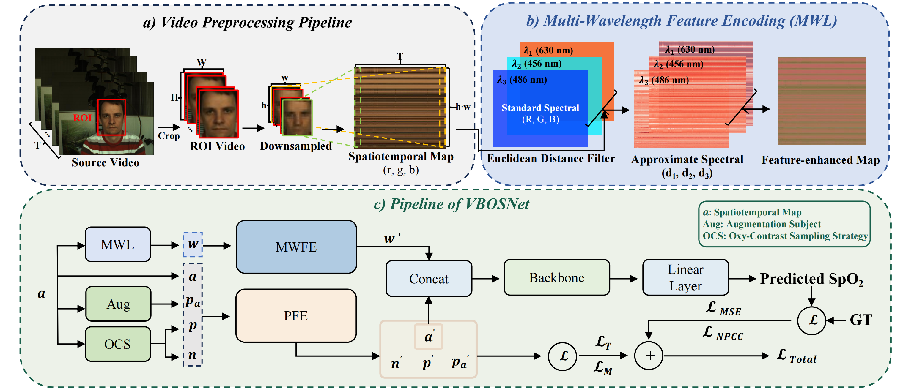

# VBOSNet

The dataset and code of **VBOSNet: A Contrastive Learning Framework for Video-Based SpO₂ Estimation in Multi-Scenario Environments**.

> **The dataset will be made available upon acceptance of the paper.**

## Framework Overview



## Code Structure

```text
VBOSNet/
├── dataloader.py
├── model.py
├── loss.py
├── engine.py
├── train.py
├── test.py
├── requirements.txt
└── README.md
```

## Installation

Use Python 3.12 and install a matching PyTorch/torchvision build for your device, followed by:

```bash
pip install -r requirements.txt
```

Training requires the DeiT initialization checkpoint `deit_tiny_patch16_224-a1311bcf.pth`.

## Training

```bash
python train.py --data data/PURE/TSI --deit-init checkpoints/deit_tiny_patch16_224-a1311bcf.pth --out outputs/seed4 --fold 01 --seed 4 --epochs 30 --ram
```
